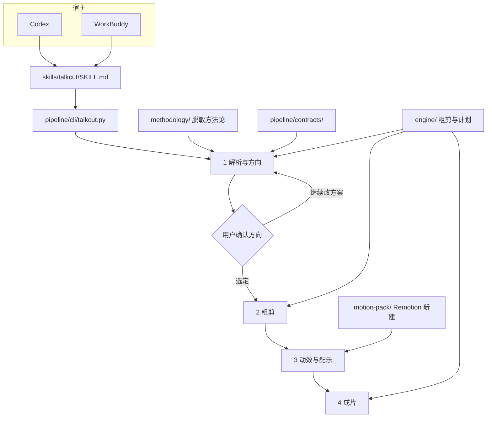

# TalkCut 架构

TalkCut 是单人口播的四段流水线。宿主（Codex 或 WorkBuddy）负责理解和确认。切点、对齐和编码在 `engine/`。动效在 `motion-pack/`：按句版式、完整字幕、字体角色。配乐只有传入 `--music` 才叠上，默认没有 BGM，也不生成节拍器。

## 总览

第 1 段可以多次出方案。确认之前没有粗剪、没有动效、没有导出。原片始终保留。

## 各段职责

| 段 | 谁来做 | 产物 |
|---|---|---|
| 1 解析与方向 | 宿主模型读方法论；引擎以后提供转写和对齐 | 方向建议，见 planning contract |
| 2 粗剪 | 引擎按切点启发式删气口、静音并重排 | 可撤销的粗剪工程 |
| 3 动效与配乐 | Remotion motion-pack | 版式计划、字幕预设；配乐仅在传入 `--music` 时存在 |
| 4 成片 | 引擎导出封面、标题和成片 | 一条成片路径 |

模型不填写音频时间码。合同里的证据是原句 id 和逐字引用。时间由对齐模块从原音算。

## 复用、改写、新建

上游是 [sayframe](https://github.com/msaysay/sayframe)（MIT）。

| 块 | 策略 | 说明 |
|---|---|---|
| `speech_alignment`、`audio_cuts`、`speech_cleanup`、`smart_pauses` | 已移植 | 气口和静音会在 `apply` 里切掉并进入导出 |
| `editor_export`、`video_finish` | 已移植可用的部分 | 成片打包和倍速校验。标题排版仍依赖上游其余模块 |
| `planning`、封面排版 | 改写为轻量实现 | `propose` 读方法论 JSON。封面命令只抽保留帧 |
| sayframe 里的课程向文稿与对应模块 | 不迁入 | 规则在 `methodology/` |
| 四段流水线与确认门 | 新建 | `apply` 必须 `confirmed: true`。动效单独成段 |
| `motion-pack/` | 新建，已接入 `motion` | 字幕、版式和可选配乐。默认 `export` 仍是 FFmpeg |
| `skills/talkcut/` | 新建 | 一份技能，Codex 与 WorkBuddy 都加载 |

移植文件保留 sayframe 的 MIT 版权声明。

## 动效系统

`plan` 写出 `layout-plan.json` 之后，`motion` 和 `export --via remotion` 按它渲染。预设只决定审美（颜色、字号、字体角色、配乐音量），不决定每一句用哪个版式。

### 字幕

1. `split_caption_phrases` 按标点和停顿切开。超过两行容量的长句，在「的 / 了 / 是」这类字后面再切。切点上的省略号、逗号不会留在屏幕上，也不会在句尾补一个 `…`。
2. 每条字幕占用互不重叠的时间。`CaptionLayer` 同一时刻只画当前一条。
3. 显示时优先一行。放不下就换到最多两行，并略缩小字号，直到整句都在画面里。禁止 `ellipsis` 截断。
4. 句子结束时淡出，然后清空。图文卡只留角色标题，避免和字幕叠成两层字。

### 版式

竖屏 `v1` 全屏加人脸上方标题，`v2` 圆形画中画，`v3` 收到右下圆角，`v4` 上下分屏，`v5` 字在人身后，`v6` 横幅。横屏 `h1` 人占三分之一，`h2` 左人右板，`h3` 约 380px 画中画，`h4` 下三分之一，`h5` 缓慢推近。规则在 `methodology/layout-rules.json`。人脸框外扩后写入 `safe-zones.json`，字幕避开它。

`v2` 的圆形画中画参考 Vibetool 口播 PiP 的位置关系，几何和遮罩是本仓库自己的实现。

### 字体角色

`setup --fonts` 把 OFL 字体放进 `runtime/fonts`。渲染时拷进工程，CSS 用角色名：`TC Body` 正文、`TC Hook` 钩子、`TC Cover` 封面、`TC Gold` 金句、`TC Number` 数字、`TC Note` 批注、`TC Fallback` 缺字。预设 JSON 的 `fontRoles` 指向这些角色。

### 可选配乐

`_music_track` 在 `music is None` 时不写文件。`musicFile` 为 null，`OffthreadVideo` 播放粗剪人声。

接入只有两条，都要用户明确给出文件：

- `--music <自备文件>`
- `examples/fetch_music.py` 下载一条需署名的可商用曲子到 `runtime/music/`，再把路径传给 `--music`

传入后配乐是单独的 `Audio`。说话、空隙、行动号召用预设里的三档音量，只 duck，不替换人声。没有节拍器鼓床。

### 对标来源

这些仓库是 MIT，这里只用思路，不拷贝源码。细节和预设表在 `motion-pack/presets/README.md`。

| 来源 | 用到的想法 |
|---|---|
| [Vibetool/talking-head-video](https://github.com/Vibetool/talking-head-video) | 讲解时圆形 PiP，人脸让开图卡 |
| [neutral-Stage/remotion-captioneer](https://github.com/neutral-Stage/remotion-captioneer) | 字幕样式做成可切换的预设包 |
| [GovinduSasanka/opus-motion-library](https://github.com/GovinduSasanka/opus-motion-library) | Opus 口播短片里的数字砍入和「长句换行并缩小」 |

`opus-clean`（`settle`）和 `opus-punch`（`slash`）是按这个审美加的预设。`clean-knowledge` 与 `gold-line` 仍然可用。

## 数据

- 方法论的机器可读部分：`methodology/EDIT_PIPELINE_HOOKS.json`
- 方向建议：`talkcut-planning-v0`
- 确认后的修改：`talkcut-edit-v0`
- 动效锁定：将来写在 `motion-pack/presets/approved.json`

三份都还没有校验器。CLI 在实现 `propose` / `apply` 时再按合同拒绝缺字段和伪造 id。

## 宿主

Codex 与 WorkBuddy 的差别只在技能目录怎么挂。对话步骤、合同和 CLI 子命令相同，见 `skills/README.md`。

工作台界面、撤销重做和跨文件编排都不在本架构的第一刀里。MVP 范围见 `docs/ROADMAP.md`。
