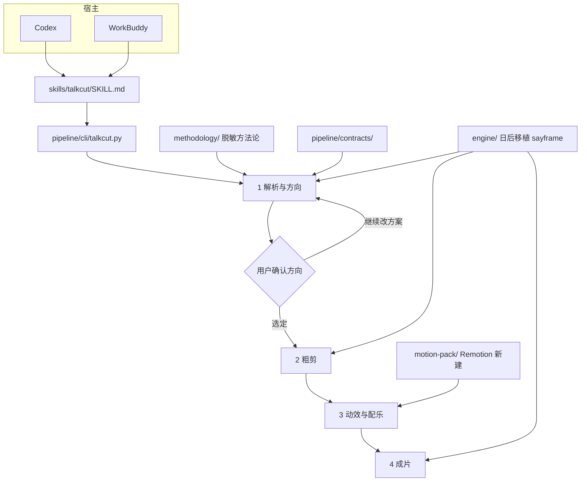

# TalkCut 架构

TalkCut 是单人口播的四段流水线。宿主（Codex 或 WorkBuddy）只负责理解和确认；切点、对齐和编码以后走本机引擎；字幕动效和鼓点配乐走新建的 Remotion 包。

## 总览

第 1 段可以多次出方案。确认之前没有粗剪、没有动效、没有导出。原片始终保留。

## 各段职责

| 段 | 谁来做 | 产物 |
|---|---|---|
| 1 解析与方向 | 宿主模型读方法论；引擎以后提供转写和对齐 | 方向建议，见 planning contract |
| 2 粗剪 | 引擎按切点启发式删气口、静音并重排 | 可撤销的粗剪工程 |
| 3 动效与配乐 | Remotion motion-pack | 锁定的 BGM 与字幕预设 id |
| 4 成片 | 引擎导出封面、标题和成片 | 一条成片路径 |

模型不填写音频时间码。合同里的证据是原句 id 和逐字引用。时间由对齐模块从原音算。

## 复用、改写、新建

上游是 [sayframe](https://github.com/msaysay/sayframe)（MIT）。

| 块 | 策略 | 说明 |
|---|---|---|
| `speech_alignment`、`audio_cuts`、`speech_cleanup` | 复用，稍后移植 | 气口、静音、对齐、清理。不在本仓库重写 |
| `planning`、`editor_export`、`covers` | 复用，稍后移植 | 方案、导出、封面。字段见 `pipeline/contracts/` |
| sayframe 里的课程向文稿与对应模块 | 改写为不迁入 | 改由 `methodology/` 的脱敏包提供规则和 JSON 钩子 |
| 四段流水线与确认门 | 新建 | 在方向和粗剪之间强制停一次；动效单独成段，模板认可后锁定 |
| `motion-pack/` | 新建 | Remotion。鼓点风 BGM 与字幕 MG，不放进 sayframe 引擎 |
| `skills/talkcut/` | 新建 | 一份技能，Codex 与 WorkBuddy 都加载 |

「复用」指以后按 MIT 保留版权声明再迁入源码。当前 `engine/` 只有这份边界说明。

## 数据

- 方法论的机器可读部分：`methodology/EDIT_PIPELINE_HOOKS.json`
- 方向建议：`talkcut-planning-v0`
- 确认后的修改：`talkcut-edit-v0`
- 动效锁定：将来写在 `motion-pack/presets/approved.json`

三份都还没有校验器。CLI 在实现 `propose` / `apply` 时再按合同拒绝缺字段和伪造 id。

## 宿主

Codex 与 WorkBuddy 的差别只在技能目录怎么挂。对话步骤、合同和 CLI 子命令相同，见 `skills/README.md`。

工作台界面、撤销重做和跨文件编排都不在本架构的第一刀里。MVP 范围见 `docs/ROADMAP.md`。
